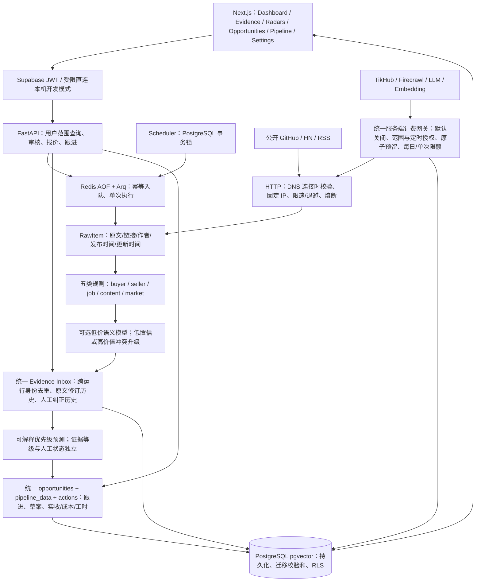

# Opportunity Radar 当前架构

审计基线：2026-10-13，main `7f6e7c4`，证据分支 `1d34837`（领先 17 次提交）。本轮在独立 `feat/production-acquisition-loop` 开发，未合并 main。历史目标架构见 MONEY_INTELLIGENCE_ROADMAP，本文件描述实际实现。

## 已实现的边界

- 保留现有 Next.js/FastAPI、Signal/Cluster/Trend/MoneyScore/Information Edge 与简报模块；没有另建 CRM。
- PostgreSQL 是实际模式的存储。内存只适用于显式开发/测试，生产启动拒绝内存、Mock、免登录和 fake-IP DNS。前端 Mock 也必须显式开启，生产保护页仍需登录。
- 计费由数据库账户锁串行检查并原子预留。未配置价格、授权、持久化上下文或定时授权则拒绝。失败不释放额度；付费传输与 Worker 不自动重试。真实费用未知保留 null，预留上限不冒充账单。
- 迁移账本逐文件检查 SHA256，只执行新增迁移。历史文件不改写；已有无账本数据库拒绝自动接管。
- AUTH_DISABLED 后端仅开发直连 loopback，拒绝所有转发头；Docker 和公网反向代理使用 JWT。本机开发 Next 必须绑定 loopback，其开发 UI 入口不替代 API 身份检查。
- Repository 所有公开业务操作限定 user。Compose 的 postgres 服务账号绕过 RLS，因此 Repository 是服务端边界；非超级用户契约测试单独验证数据库 RLS。生产应使用专用后端角色并避免暴露数据库。
- 原文更新不会新增同一客户机会：保存证据旧版本；已核实证据和关联线索退回 disputed。业务成交历史不会被覆盖。
- Pipeline：新发现 → 待核实 → 已核实 → 待联系 → 已联系 → 已回复 → 已报价 → 洽谈中 → 已成交/流失。保留旧收藏/忽略状态；推进销售必须人工核实；流失必须原因。
- 报价使用人工输入费率、工时与范围生成可编辑三档草案。沟通草案不发送消息，不自动记录联系/回复/报价。
- 获客漏斗来自采集收据、唯一证据与实际阶段时间戳。缺少分母、账单或实收时为 null；日界 UTC。

## 来源能力与验证层级

| 来源 | 已实现 | 当前证据边界 |
|---|---|---|
| GitHub | 仓库搜索、`issues:` 公开开放 Issue、page 分页、更新时间 | 本轮真实免费 Issue 响应解析验证；仓库原有契约测试 |
| Hacker News | 帖子、`comments:` 评论、page 分页、父帖关系 | 本轮真实免费评论响应解析验证 |
| RSS | 合法公开订阅、时间、链接 | 离线契约测试；没有本轮真实 RSS 探针 |
| TikTok / 抖音 / 小红书 / 微博 / 知乎 | TikHub adapter、时间与类型、国内显式游标、抖音带 ID 评论独立归属 | 合成响应契约；未获真实付费验证授权，不能称官方 schema 已确认 |
| Web Search | Firecrawl 搜索 | 离线契约；真实付费禁用 |

续页必须手动请求并再次确认收费。跨运行唯一身份和已出现记录更新已实现；长期 watermark、自动断点恢复、跨进程共享来源熔断尚未完成。用户核实和真实联系/成交必须由本人执行。

## 部署和验证

参见 [README](README.md)、[本轮审计与交付](docs/PRODUCTION_UPGRADE.md)。CI 覆盖 `feat/**` push 与全部 PR：前端四项、真实 PostgreSQL/pgvector 与 Redis 契约、重复迁移、Compose 健康与重启持久化。真实生产 Supabase 登录端到端、付费模型/国内 API 和客户转化仍需单独验收。
