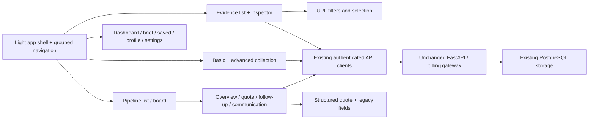

# Frontend experience upgrade — 2026-10-15

## Scope and boundaries

Whole-site light workspace using the existing Next.js, Tailwind, Lucide and Radix stack. No backend API, database schema, billing logic, classification or scoring algorithm changes. TikHub, paid AI, Firecrawl and paid scheduler remain disabled. No customer contact, business-data deletion or main merge.

The design uses Linear Inbox's compact scanning hierarchy and Attio's navigation grouping. It does not reproduce their branding or sample performance. System CJK fonts, 224px navigation, 56px header, slate surfaces and indigo actions are shared across all routes.

## Delivered behavior

- Evidence Inbox: compact list with source, original publication time/unknown, budget/unknown, prediction and human status. A 400px inspector at >=1280px, accessible drawer below; selecting never verifies evidence. Billing/source statistics fold away; the collector still exposes price verification, blocked reasons and paid confirmation before a request.
- Category/source/status/sort/selection/search restore from URL and browser history. Notes, contacts and quote drafts are not serialized into URLs. Failed note saves retain input per evidence item and expose retry.
- Collection/Radars: 24h/3d/7d/30d and custom hours, basic configuration followed by advanced filters and source limitations. Existing idempotency/cursor policy is retained.
- Pipeline defaults to a list, retaining board, stage/today/overdue filters. Client inspector uses Overview, Quote, Follow-up and Communication tabs with persistent local input, close/discard confirmation and unload protection.
- Quotes use editable packages plus readable preview, separate preview/save actions, collapsed version history and advanced JSON fallback. Unknown top-level, package and payment-node fields survive structured preview updates. Selling rate and internal cost remain separate; missing cost yields unknown profit.
- Dashboard prioritizes real acquisition counts and pending work; full funnel, rates and billing expand on demand. Opportunities/Saved share toolbar and row hierarchy. Daily brief, detail not-found/loading/error states and Settings groups use the same visual system.
- Profile waits for save and reports failure/success. Skills use enable/disable copy for local preferences. Landing no longer displays fixed scans/opportunities/income. Onboarding is manual and awaits successful profile persistence.

## Architecture

## Functional verification

Main runtime: `127.0.0.1:3002` / API `8013`, PostgreSQL. UI QA runtime: `3003` / API `8014`, volatile development storage and separate identity ending `0099`. `scripts/seed-ui-qa.py` refuses any runtime except the fixed QA port reporting volatile storage. Its 100 deterministic, explicitly labeled samples never reach the main API/database. These are UI fixtures, not real customers or classification accuracy evidence.

Ego TaskSpace 24 exercised:

1. Search a fixture and open details; status stays unverified.
2. Save a note, block the QA review URL using CDP, edit again, observe network failure and retained input, unblock and retry successfully.
3. Explicitly verify and convert a fixture; read it in the existing Pipeline.
4. Preview three packages at a manually entered rate; saved version remains 0. Save => version 1. Different deliverables, revisions and timelines remain visible; unknown internal cost => unknown profit.
5. Append a follow-up linked to quote version 1. Switch tabs before saving: input retained. Close with unsaved changes: discard confirmation; cancel retains the editor and input. Save appends the record without marking contact or revenue.
6. Mobile drawer has one detail form, full viewport width, Escape closes; list scroll 700px before/after. Browser Back reopens prior selection. Navigation Escape restores focus to its trigger.
7. Small-screen source selection still reports “接口价格未核实，付费采集被阻止”; Start remains disabled. No collection request was sent.
8. Reduced-motion media produces `transition-duration: 0s`. Regular text/muted/action colors meet AA against their surfaces (primary text #111827, muted #526072, action #4F46E5).

## Layout and visual review

First-row top, with 100 fixtures, collector/statistics closed, scroll 0:

| Viewport | First row | Horizontal page overflow |
|---|---:|---|
| 375×844 | 411px | none |
| 390×844 | 411px | none |
| 768×900 | 386px | none |
| 1024×900 | 368px | none |
| 1280×800 | 320px | none |
| 1440×900 | 320px | none |

Before values supplied in the approved plan: desktop857px / mobile1271px. Current values are live browser measurements, not mocked geometry.

Two actual screenshot/review rounds were performed. Round 1 found the phone filters still placed the first row at526px; mobile category/status selects reduced it to411px. Round 2 removed the large grade gutter and corrected sticky inspector displacement caused by an overflow container. Desktop and mobile list/details, plus saved quote packages, were actually viewed.

15 routes ×4 widths (375/768/1024/1440) produced60 overflow checks with no failures; the six evidence widths above were checked separately. Missing-detail routes were included. Native Ego zoom commands are disabled while agent-controlled; a CDP 2x visual viewport check succeeded without horizontal page overflow. **Native desktop browser 200% reflow is still an explicit acceptance gap.**

Night Eye initially recolored the application and invalidated palette review. The local QA site was set to NORMAL through its extension popup before the final captures. Extension-injected translation widgets and Next development indicators are environment overlays, not shipped UI. No extension-disabling code was added to the application.

Local evidence: `outputs/ui-layout-final.json`, `outputs/ui-route-widths.json`, `outputs/ui-frontend-tests.log`, `outputs/ui-backend-tests.log`, `outputs/ui-production-build.log`, `.ui-design/runs/20261015T163247-999951b5/`.

## Checks and release

- ESLint and TypeScript pass.
- Vitest:46 tests pass. New tests cover URL recovery/validation and preservation of legacy quote/package/payment fields.
- Backend:343 pass, no skips, with REQUIRE_POSTGRES_TESTS=true and Redis configured; includes PostgreSQL/pgvector, migrations, RLS, isolation and concurrency contracts. One upstream Starlette deprecation warning remains.
- Next production build passes. Feature-branch/PR CI includes frontend, backend and isolated Compose restart/persistence jobs. Exact-HEAD CI is reported through PR #2 Checks after push.
- Commits: `5679097` light foundation; `13a8731` compact evidence and configuration; third batch extends the shared patterns to all remaining pages and records this validation.

Run the usual API and `npm run dev -- --hostname 127.0.0.1 --port 3002`; no migration or new runtime dependency is needed. Review [PR #2](https://github.com/Joho6666/opportunity-radar/pull/2). This frontend change does not establish improved buyer accuracy, domestic live API compatibility, human identity or real conversion.
